  

  

  
  
  
  

<h3 align="center">On a journey to build software that solves real problems 🚀</h3>

  

## Namaste 🙏

I'm **Naveen Kumar**, a Computer Science and Engineering student at **VIT-AP University**, India 🇮🇳 (Class of 2027, CGPA 9.09).

I love building **full-stack web applications** from the database up: designing the schema, writing the REST API, and shipping a clean, responsive UI on top. My favourite problems are the tricky ones, like making sure two people can never book the same train seat at the same moment.

I've led **4+ team projects** and solved **600+ DSA problems** on LeetCode.

**I'm very passionate about:**

- 🌐 **Full-stack web development**
- 🖥️ **Software development** and clean, working code
- 🧩 **Problem solving** with data structures & algorithms
- ☁️ Exploring **cloud** with AWS

 

## 🚧 Present Status

👉 Learning **Java, React, Node.js, Express, MongoDB, MySQL and AWS**

👉 Building real-world **full-stack projects** and deploying them live

👉 Shipping **[Placement Form Autofiller](https://github.com/naveenk2608/placement-form-autofiller)**, a Chrome extension that fills placement-drive forms in one click

👉 Sharpening **DSA and problem solving** on [LeetCode](https://leetcode.com/u/logicMind26/)

`Update · Nov 2026:` Placement Form Autofiller **v0.2.0 "Fill any website"** is tagged. It now works on job application forms beyond Google Forms.

## 🌟 Featured Projects

<table>
  <tr>
    <td width="50%" valign="top">

### 🚆 [Rail-Sphere](https://github.com/naveenk2608/Rail-Sphere)

A full-stack **train ticket booking system** with route-based seat allocation: a seat booked A→C can still be sold for D→F. Concurrent bookings are serialized with row locks, and a stress test fires hundreds of simultaneous requests at one seat to prove exactly one wins. PNR status, email tickets and JWT login.

`React` `Vite` `Node.js` `Express` `MySQL` `JWT` `Nodemailer`

🔗 [**Live demo**](https://rail-sphere.vercel.app) · [Repo](https://github.com/naveenk2608/Rail-Sphere)

</td>
    <td width="50%" valign="top">

### 📝 [BlogSpace](https://github.com/naveenk2608/Blog-Space)

A full-stack **blogging platform** with JWT auth, a draft-and-publish workflow, Cloudinary image uploads, public author profiles, comments, and likes on both posts and comments.

`React` `Vite` `Node.js` `Express` `MySQL` `Cloudinary`

🔗 [**Live demo**](https://blog-space-eight-sepia.vercel.app) · [Repo](https://github.com/naveenk2608/Blog-Space)

</td>
  </tr>
  <tr>
    <td width="50%" valign="top">

### ⚡ [Placement Form Autofiller](https://github.com/naveenk2608/placement-form-autofiller)

A **Chrome extension** that fills placement-drive Google Forms and job forms from a profile saved on your own computer. It matches labels like "Reg No." or "VIT ID" to the right field, colour-codes each answer by confidence, supports undo, and never sends your data anywhere.

`TypeScript` `Chrome Extension (MV3)` `WXT` `Vitest` `Playwright`

🔗 [Repo](https://github.com/naveenk2608/placement-form-autofiller)

</td>
    <td width="50%" valign="top">

### 🔀 [AI Gateway](https://github.com/naveenk2608/ai-gateway)

A self-hostable **API gateway** that sits in front of model providers and handles the backend plumbing: per-project API keys, rate limits and budgets, retries with failover to a backup provider, and a usage record for every request, all viewable in a dashboard.

`TypeScript` `Node.js` `Fastify` `PostgreSQL` `Redis` `React` `Docker`

🔗 [**Live demo**](https://ai-gateway-8var.onrender.com) (free tier, may take a minute to wake) · [Repo](https://github.com/naveenk2608/ai-gateway)

</td>
  </tr>
</table>

## 🛠️ Tech Stack

<table>
  <tr>
    <td><b>Languages</b></td>
    <td></td>
  </tr>
  <tr>
    <td><b>Frontend &amp; Backend</b></td>
    <td> </td>
  </tr>
  <tr>
    <td><b>Databases</b></td>
    <td></td>
  </tr>
  <tr>
    <td><b>Cloud &amp; Deployment</b></td>
    <td> </td>
  </tr>
  <tr>
    <td><b>Testing &amp; Tools</b></td>
    <td>  </td>
  </tr>
</table>

**What my projects show:** `REST APIs` `JWT Authentication` `Relational Database Design` `Concurrency Control` `Responsive UI` `Chrome Extensions` `Automated Testing` `CI/CD`

## 📊 GitHub Stats

  
  

  

  

  <picture>
    <source media="(prefers-color-scheme: dark)" srcset="https://raw.githubusercontent.com/naveenk2608/naveenk2608/output/github-snake-dark.svg" />
    <source media="(prefers-color-scheme: light)" srcset="https://raw.githubusercontent.com/naveenk2608/naveenk2608/output/github-snake.svg" />
    
  </picture>

## 🤝 Let's Connect

  
  
  
  <!-- To add LinkedIn, paste your profile URL in place of YOUR-LINKEDIN-ID and remove these comment markers:
  
  -->

  

<h4 align="center">⭐ Thanks for stopping by! Feel free to explore my repos and say hello.</h4>
